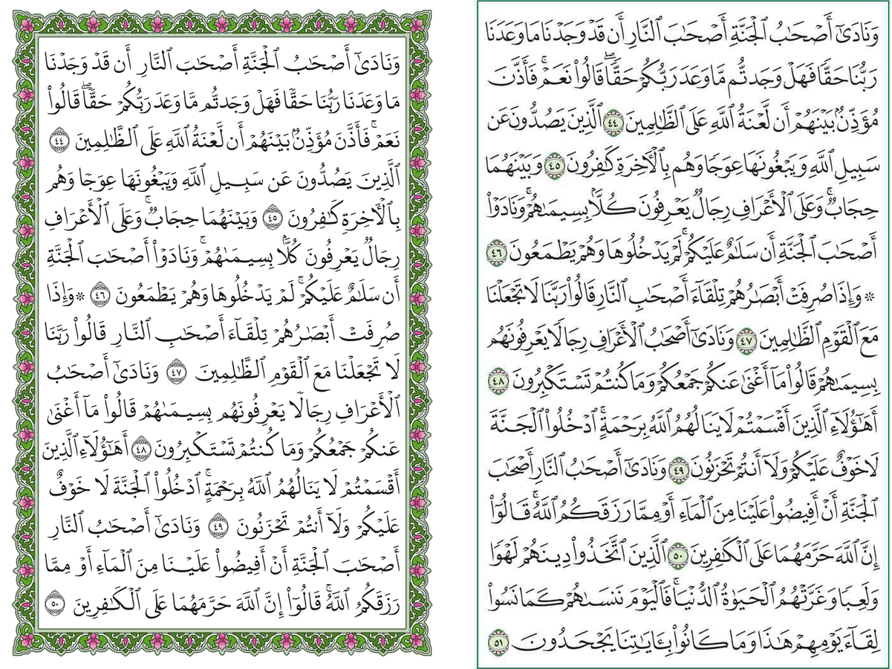

# Quran-Nazm

**Quran-Nazm** (نظم, "arrangement") is an automatic, rule-based typesetter for the Quran. It sets the Hafs text in [DigitalKhatt](https://digitalkhatt.org)'s Madina font and replaces the manual layout of the printed Mushaf with explicit rules, so every page and every line follows the same logic.

<p align="center">
  
  <br><sub>Al-A'raf 44 onward: Quran-Nazm page 155 on the left, the Madina 1441H print page 156 on the right.</sub>
</p>

## Why

Every Mushaf starts from the same problem: the traditional reading units are unequal. The longest rub' holds 2.19× the text of the shortest, hizbs differ by 1.35× and even juz by 1.16×. Fixing a unit to a page count means absorbing that variance somewhere.

- **The Madina Mushaf** fixes each juz to 20 pages, the most forgiving unit, and absorbs the rest by hand. Measured on the 1441H print, a full line holds anywhere from 4 to 15 words, a third of all lines are more than 10% too long or too short for the line width, and pen weight drifts from line to line and page to page.
- **Quran-Nazm** fixes the same unit, every juz on exactly 20 pages, and absorbs the variance by rule instead of by hand. It keeps the hand and makes the setting even: lines on a page vary 35% less than in the print (0.040 vs 0.062), pages of a juz 27% less (0.048 vs 0.066), all line stretch 22% less (0.081 vs 0.104), every juz begins on a known page, and the pen is the same on every line. An earlier version fixed every hizb to 10 pages; it costs more variance than it removes (see [`docs/findings.md`](docs/findings.md), section 9), and remains available as `--unit hizb`.

Full evidence and decisions: [`docs/findings.md`](docs/findings.md), and the paper in [`paper/`](paper/).

## The rules

- **Every juz fills exactly 20 pages** of 15 lines; juz 30, with its 37 short surahs, the one exception, fills 24. Hizbs start wherever the text puts them.
- **Every page ends with an ayah number**, and no line starts with an ayah marker.
- **Each juz is set as one unstretched line**, cut into 20 equal pages at ayah ends, then each page into 15 equal lines at word boundaries, balancing shaped text widths. Both sets of cuts are chosen by dynamic programming.
- **Every surah starts on a new line** under its header, and short surahs are kept whole on one page wherever page balance allows.
- **No surah title below line 11**, so a surah never begins with a line or two at the foot of a page before a page break.
- **One line width for the whole book.** Lines stretch with DigitalKhatt's letter elongation, and compress by at most 19%, by tightening spaces and then a horizontal scale; the font's shrinking features are never used.
- **No word may touch its neighbour.** Every line is checked for ink contact, and touching words get a little more space.

## Output

[`output/quran-nazm.pdf`](output/quran-nazm.pdf): 604 pages (the same count as the print), 145 × 210 mm, vector text, one bookmark per surah, type at 93% of the Madina print. A static cover with a short description comes first, and the file opens two pages at a time, so a two-page viewer shows the cover on the left and page 1 on the right (`--no-cover` leaves it out). [`output/quran-nazm-summary.txt`](output/quran-nazm-summary.txt) is the short statistics summary every run prints, beside the print's values. Page frames and surah headers use the Hafs al-'Adi vector art from [quran-assets](https://quran.ws/blocks/quran-assets). [`output/quran-nazm-report.json`](output/quran-nazm-report.json) records the statistics and the rule checks of each render; the renderer is deterministic.

To generate it yourself, see [`docs/RENDERING.md`](docs/RENDERING.md). In short:

```bash
git clone -b v2.0 https://github.com/tarekeldeeb/quran-madina-html.git ../quran-madina-html
pip install uharfbuzz fonttools brotli numpy freetype-py pymupdf
python scripts/00_prepare.py
python scripts/render_mushaf.py
```

## Paper

**Quran-Nazm: Reducing Layout Variance in Quran Typesetting**, Tarek Eldeeb. Full paper in the ACM format (9 pages), aimed at the ACM Symposium on Document Engineering (DocEng). Sources, figures and build instructions are in [`paper/`](paper/), and the compiled PDF is [`paper/main.pdf`](paper/main.pdf).

```bibtex
@misc{eldeeb2026nazm,
  author       = {Tarek Eldeeb},
  title        = {Quran-Nazm: Reducing Layout Variance in Quran Typesetting},
  year         = {2026},
  howpublished = {\url{https://github.com/tarekeldeeb/quran-nazm}}
}
```

## Repository

| Path | Content |
|---|---|
| `scripts/render_mushaf.py` | the typesetter: layout and PDF writer |
| `scripts/00_prepare.py` | extracts fonts (and scan pages, for the analysis) |
| `scripts/10_*` … `scripts/72_*` | the research scripts behind each finding and every table of the paper, numbered by stage |
| `scripts/joint_layout.py` | exact joint page and line breaking (nested dynamic programming, checked with HiGHS) |
| `docs/findings.md` | measurements, comparisons and decisions |
| `docs/RENDERING.md` | how to generate the PDF, step by step |
| `docs/madina-variance-evidence.html` | evidence document: line density, pen weight, ayah markers in the Madina print |
| `docs/hizb-layout-study.html` | hizb sizes, layout renders and shrink-limit comparison |
| `figures/` | crops of the Madina print used as evidence, and sample Nazm pages |
| `data/` | rub' boundaries and derived measurements |
| `output/` | the rendered PDF, its statistics report and the full page layout |
| `paper/` | the paper: LaTeX sources (ACM `acmart`), figures, build script and PDF |

## License

Dual-licensed: free for non-commercial use under the [Waqf Public License 2.0](https://github.com/ojuba-org/waqf/tree/master/2.0); any commercial use needs prior written permission. See [`LICENSE`](LICENSE). The licence covers this project's own code, documents and renders; third-party material keeps its own terms (see Credits). In particular, the page frame and surah header art in `assets/art/` and in the rendered PDF is CC BY-NC-SA 4.0 (provisional, from quran-assets): non-commercial use only, with attribution. `python scripts/render_mushaf.py --art none` renders the Mushaf with Quran-Nazm's own frame and headers instead.

## Credits

- Text, layout data, fonts and justifier: [quran-madina-html](https://github.com/tarekeldeeb/quran-madina-html), which builds on [DigitalKhatt](https://github.com/DigitalKhatt) by Amine Anane and on the [Tanzil](https://tanzil.net) text.
- Rub' boundaries: [quran-meta](https://www.npmjs.com/package/quran-meta) (MIT).
- Running heads and page numbers: [Amiri Quran](https://www.amirifont.org) by Khaled Hosny.
- Page frame and surah header art: [quran-assets](https://github.com/quran-ws/quran-assets) by quran.ws, Hafs al-'Adi style, traced from the King Fahd Complex's standard Hafs Mushaf. See [`assets/art/hafs-adi/README.md`](assets/art/hafs-adi/README.md).
- Madina Mushaf images in `figures/` are crops of the King Fahd Complex for the Printing of the Holy Quran edition, reproduced for analysis.
