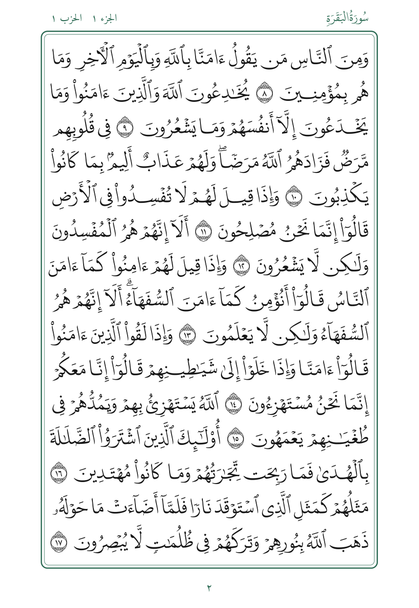
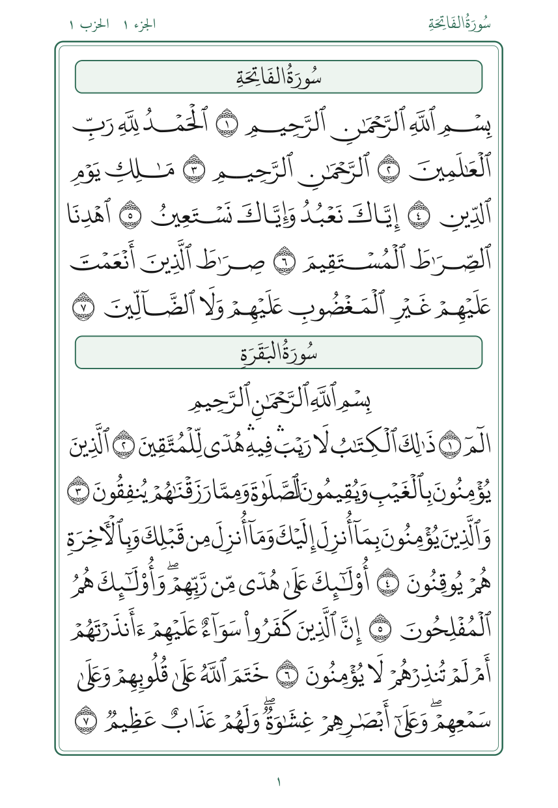

# Quran-Nazm

**Quran-Nazm** (نظم, "arrangement") is an automatic, rule-based typesetter for the Quran. It sets the Hafs text in [DigitalKhatt](https://digitalkhatt.org)'s Madina font and replaces the manual layout of the printed Mushaf with explicit rules, so every page and every line follows the same logic.

<p align="center">
  
  
</p>

## The rules

- **Every hizb fills exactly 10 pages** of 15 lines (juz 30 is the one exception).
- **Every page ends with an ayah number**, and no line starts with an ayah marker.
- **Each hizb is set as one unstretched line**, cut into 10 equal pages at ayah ends, then each page into 15 equal lines at word boundaries.
- **Every surah starts on a new line** under its header.
- **One line width for the whole book.** Lines stretch with DigitalKhatt's letter elongation, and compress by at most 25%.

## Why

Measured on the King Fahd Complex 1441H print, the same line width holds anywhere from 4 to 15 words. A third of all lines are more than 10% too long or too short for it, and pen weight drifts from line to line and page to page. Quran-Nazm keeps the hand and makes the setting even: lines on a page vary 40% less than in the print (0.039 vs 0.065), every hizb begins at a predictable place, and the pen is the same on every line.

Full evidence and decisions: [`docs/findings.md`](docs/findings.md).

## Output

[`output/quran-nazm.pdf`](output/quran-nazm.pdf): 607 pages, 145 × 210 mm, vector text, one bookmark per surah, type at 93% of the Madina print.

To generate it yourself, see [`docs/RENDERING.md`](docs/RENDERING.md). In short:

```bash
git clone -b v2.0 https://github.com/tarekeldeeb/quran-madina-html.git ../quran-madina-html
pip install uharfbuzz fonttools brotli numpy
python scripts/00_prepare.py
python scripts/render_mushaf.py
```

## Repository

| Path | Content |
|---|---|
| `scripts/render_mushaf.py` | the typesetter: layout and PDF writer |
| `scripts/00_prepare.py` | extracts fonts (and scan pages, for the analysis) |
| `scripts/10_*` … `scripts/64_*` | the research scripts behind each finding, numbered by stage |
| `docs/findings.md` | measurements, comparisons and decisions |
| `docs/RENDERING.md` | how to generate the PDF, step by step |
| `docs/madina-variance-evidence.html` | evidence document: line density, pen weight, ayah markers in the Madina print |
| `docs/hizb-layout-study.html` | hizb sizes, layout renders and shrink-limit comparison |
| `figures/` | crops of the Madina print used as evidence, and sample Nazm pages |
| `data/` | rub' boundaries and derived measurements |
| `output/` | the rendered PDF, its statistics report and the full page layout |

## Credits

- Text, layout data, fonts and justifier: [quran-madina-html](https://github.com/tarekeldeeb/quran-madina-html), which builds on [DigitalKhatt](https://github.com/DigitalKhatt) by Amine Anane and on the [Tanzil](https://tanzil.net) text.
- Rub' boundaries: [quran-meta](https://www.npmjs.com/package/quran-meta) (MIT).
- Madina Mushaf images in `figures/` are crops of the King Fahd Complex for the Printing of the Holy Quran edition, reproduced for analysis.
